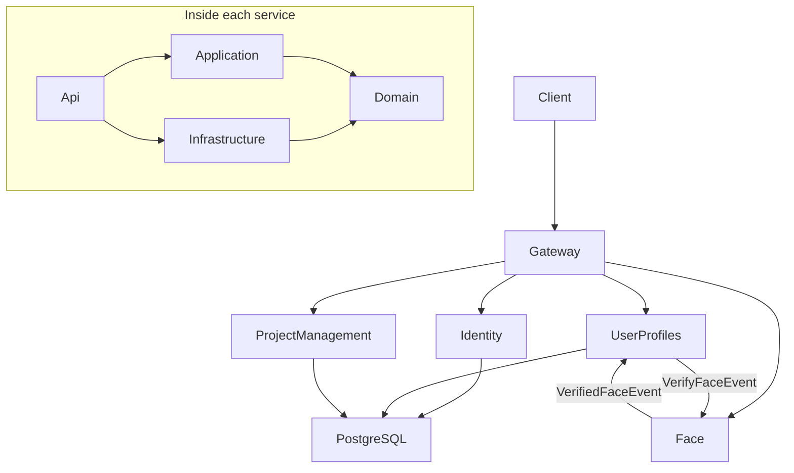

# Refactor plan

Status: **Phase 0 (discovery) complete. Nothing has been changed except adding this file. Waiting for approval.**
Baseline taken on `master` at `3ca3a83`.

Paths below are shortened: `Identity.Api/...` means `Freelance.Identity/src/Freelance.Identity.Api/...`.

## 1. Summary

The codebase is already largely modern: .NET 10, Minimal APIs on `WebApplication.CreateBuilder`, file-scoped
namespaces, primary constructors, nullable enabled, Central Package Management, no obsolete-API warnings and no
blocking async calls. About 4,800 lines of production code, no class over 150 lines. The useful work is therefore
**smaller than the brief suggests**: removing duplication and dead code, typed options, a testable clock, naming,
and a few query inefficiencies. There is no UI, so every Blazor/Razor item is not applicable.

## 2. Architecture

| Solution | Type | Projects |
|---|---|---|
| ApiGateway | ASP.NET Core: Ocelot gateway + aggregated OpenAPI | 1 |
| Face | Minimal API + SignalR + RabbitMQ consumer (Wolverine), dlib | Api, Application, Domain, Infrastructure |
| Identity | Minimal API, issues JWTs | Api, Application, Domain, Infrastructure |
| ProjectManagement | Minimal API | Api, Application, Domain, Infrastructure |
| UserProfiles | Minimal API + RabbitMQ publisher/consumer with durable outbox | Api, Application, Domain, Infrastructure |
| Shared.Events | Message contracts, published as a NuGet package | 1 |

Each service solution also has a unit and an integration test project.

Package dependencies per layer: Api uses `Shared.Api`; Domain uses `Shared.Domain` (Face.Domain uses nothing);
Infrastructure uses `Shared.Infra`; Face.Application and UserProfiles.Application use `Freelance.Shared.Events`.
`Face.Infrastructure` also references the `Microsoft.AspNetCore.App` framework (for the SignalR hub).

| Concern | Implementation |
|---|---|
| Mediator and messaging | Wolverine; FluentValidation as middleware |
| Data access | EF Core on PostgreSQL, repositories + unit of work from `Shared.Infra`, migrations applied at startup |
| Auth | JWT bearer (from `Shared.Api`), role policies `ClientOnly` / `FreelancerOnly` |
| Errors | `Shared.Api` global exception handler + one `IExceptionProblemDetailsMapper` per service |
| Observability | OpenTelemetry (traces, logs) via `Shared.Api`, health checks |
| Background work | Wolverine message handlers only |
| External integrations | PostgreSQL, RabbitMQ, Tempo, Loki, downstream OpenAPI documents (typed `HttpClient`) |

`Shared.Api`, `Shared.Domain` and `Shared.Infra` come from a private feed; their source is not in this repository
and is out of scope.

## 3. Baseline

| Solution | restore | build warnings / errors | format | unit | integration |
|---|---|---|---|---|---|
| ApiGateway | ok | 0 / 0 | clean | 21 pass | 20 pass |
| Face | ok | 0 / 0 | clean | 37 pass | 11 pass |
| Identity | ok | 0 / 0 | clean | 96 pass | 39 pass |
| ProjectManagement | ok | 0 / 0 | clean | 142 pass | 60 pass |
| UserProfiles | ok | 0 / 0 | clean | 138 pass | 56 pass, 1 skipped |
| Shared.Events | ok | 0 / 0 | checked in CI | none | none |

- Total: **621 tests, 620 pass, 1 skipped** (known bug: no unique index on profile `AccountId`). No failures.
- No CS0618, SYSLIB or nullable warnings.
- "0 warnings" is with these rules suppressed in `*/Directory.Build.props`: CA1515, CA1848, CA1873, CA1708
  (plus NETSDK1206 in Face, and a longer list for test projects).
- SDK 11.0.100 (pinned in `global.json`), target `net10.0`. Integration tests ran against PostgreSQL via Podman.

## 4. Problems found

### 4.1 Configuration and secrets
| Where | Problem |
|---|---|
| `ApiGateway/appsettings.json:5` | A JWT signing key is committed in the **non-Development** settings file (see D1) |
| `docker-compose.yml:13,40,41,68,69,74,108,133` | Literal signing key, database and RabbitMQ passwords (see D1) |
| `*/Program.cs` (Gateway 11-13, Face 17-19, Identity 16-18, ProjectManagement 17-19, UserProfiles 18-20) | Raw `IConfiguration` reads with repeated default URLs |
| `ApiGateway/Services/OpenApiAggregatorService.cs:21,22,54` | Binds `Routes` and `SwaggerEndPoints` on every call; no options type or validation |
| `ApiGateway/Program.cs:21-22` | CORS origins assembled inline |
| `Face.Api/Endpoints/CameraEndpointGroup.cs:17` | Reads `FRONTEND_BASE_URL` per request |
| `Face.Api/Program.cs:46` | Binds `RabbitMqOptions` a second time, outside the validated options |

### 4.2 Duplication
| Where | Problem |
|---|---|
| `Identity.Api/Endpoints/UserEndpointGroup.cs:65`; `ProjectEndpointGroup.cs:31,47,57`; `ProjectTaskEndpointGroup.cs:35,51,61`; `ClientProfileEndpointGroup.cs:35,48,57,67,77,88`; `FreelancerProfileEndpointGroup.cs:38,52,62,72,82,99,110` | The same "get account id or return 401" guard about 20 times |
| `*ExceptionMapper.cs` / `ProjectManagementMapper.cs` | `Create`, `CreateValidation` and the common switch arms copied three times (see D5) |
| `ProjectManagement.Api/AuthorizationPolicies.cs`, `UserProfiles.Api/AuthorizationPolicies.cs` | Identical (see D5) |
| `*/Program.cs` | Same telemetry and Wolverine setup repeated; DI is not grouped into `Add<Feature>()` methods |
| `UserProfiles.Infrastructure/.../FreelancerProfileService.cs:25` | Re-implements `GetByIdWithTracking`, as in ProjectManagement's `TrackingRepository.cs:16` |
| Role names | `"Client"`/`"Freelancer"` literals in `Role.cs:8-9`, both `AuthorizationPolicies.cs:10`, `ProfileRoles.cs:6-7`, `ProjectTaskEndpointGroup.cs:29` |
| Column limits | Lengths typed twice: validators and EF configurations (all three database services) |

### 4.3 Dead or leftover code
| Where | Problem |
|---|---|
| `UserProfiles.Domain/Exceptions/FaceNotMatchException.cs` and its mapper arm | Never thrown |
| `ApiGateway/Models/SwaggerConfig.cs:6` | `Version` is never read |
| `ProjectManagement.Domain/Interfaces/ITimeLogRepository.cs:10` | `GetByIdWithTrackingAsync` has no production caller |
| `Project.cs:89`, `ProjectTask.cs:70` | `AssignFreelancer` is only called by tests (see D6) |
| Five `*.http` files | Template `/weatherforecast` requests that do not exist |
| Tracked `*.csproj.user` files (Face, ProjectManagement, UserProfiles) | Per-developer files |
| `.gitignore:7` | Entry for a solution that does not exist (`Frelance.API.sln`) |
| `Freelance.ApiGateway.sln` | Duplicate of the `.slnx`; nothing references it |

### 4.4 SOLID and layering
| Where | Problem |
|---|---|
| `Face.Infrastructure/Hubs/CaptureHub.cs` | A web transport concern in Infrastructure; belongs in Api |
| `Face.Infrastructure/Services/FaceService.cs` | One class does model location, temp-file handling, detection and embedding; `TryGetFaceDescriptor` is 47 lines |
| `Identity.Infrastructure/Persistance/Repositories/JwtTokenService.cs`, `PasswordService.cs` | Security services filed as repositories |
| `UserProfiles.Infrastructure/.../FreelanceProfileConfiguration.cs:10` | 46-line `Configure` |
| `UserProfiles.Application/Mappings/SkillResolution.cs` | Persistence logic inside a "Mappings" folder |

### 4.5 Testability, EF Core and analyzers
| Where | Problem |
|---|---|
| `Account.cs:47,64`; `Project.cs:53,63,73,84`; `ProjectTask.cs:46,58,67`; `TimeLog.cs:31`; `BaseUserProfile.cs:32,39,51`; `FreelancerProfile.cs:59,70,78,87` | `DateTime.UtcNow` in the domain; `TimeProvider` is only used for tokens |
| `SkillResolution.cs:20` | One query per skill (N+1) |
| The `GetAll`/`GetById` query handlers | Load full entities and map in memory instead of projecting; tracking behaviour of `Shared.Infra`'s `GetAllAsync` needs checking |
| `*/Directory.Build.props` | CA1848, CA1873, CA1515, CA1708 suppressed for whole solutions (see section 6) |
| `UpdateProjectTaskReuqest`, `ProfileAllreadyExistsException`, `FreelacerId`, folders `Persistance`, `Querires`, `Queies`, `interfaces`, `Repository`; `ClientProfileService`/`FreelancerProfileService` are repositories; `VerifiedFace.cs` holds `VerifiedFaceEvent` | Naming (see D2-D4) |

### 4.6 Checked and clean
No `.Result`/`.Wait()`/`async void`, `new HttpClient()`, Newtonsoft, Swashbuckle, legacy hosting, `BinaryFormatter`,
`WebClient`, `NotImplementedException`, service locator, `#pragma warning disable`, interpolated log calls,
block-scoped namespaces or commented-out code were found by search.

## 5. Packages

"Latest" is from nuget.org on the baseline date. No deprecated or vulnerable packages (transitive included).
No newer version exists within any current major line.

| Package | Current | Latest | Breaking? | Action |
|---|---|---|---|---|
| Microsoft.AspNetCore.Mvc.Testing | 10.0.15 | 11.0.0 | major, targets .NET 11 | keep on 10.x |
| Microsoft.AspNetCore.OpenApi | 10.0.15 | 11.0.0 | major | keep |
| Microsoft.AspNetCore.SignalR.Client | 10.0.15 | 11.0.0 | major | keep |
| Microsoft.EntityFrameworkCore.Design | 10.0.15 | 11.0.0 | major | keep |
| Microsoft.EntityFrameworkCore.Tools | 10.0.15 | 11.0.0 | major | keep; see D7 |
| Microsoft.Extensions.Logging.Abstractions | 10.0.15 | 11.0.0 | major | keep |
| System.Drawing.Common | 10.0.15 | 11.0.0 | major | keep (security pin over DlibDotNet's 5.0.1) |
| System.Numerics.Tensors | 10.0.15 | 11.0.0 | major | keep |
| AwesomeAssertions | 9.6.0 | 9.6.0 | | none |
| BCrypt.Net-Next | 4.2.0 | 4.2.0 | | none |
| DlibDotNet | 19.21.0.20220724 | same | | none (unmaintained for years; watch) |
| FluentValidation | 12.2.0 | 12.2.0 | | none |
| Microsoft.IdentityModel.JsonWebTokens | 8.23.0 | 8.23.0 | | none |
| Microsoft.Testing.Extensions.CodeCoverage | 18.12.0 | 18.12.0 | | none |
| Microsoft.VisualStudio.Azure.Containers.Tools.Targets | 1.23.0 | 1.23.0 | | none (Visual Studio container support) |
| Moq | 4.21.0 | 4.21.0 | | none |
| Ocelot | 25.0.3 | 25.0.3 | | none |
| Testcontainers.PostgreSql | 4.17.0 | 4.17.0 | | none |
| WolverineFx.RuntimeCompilation | 6.65.1 | 6.65.1 | | none |
| xunit.v3 | 4.0.3 | 4.0.3 | | none |
| Shared.Api / Shared.Domain / Shared.Infra | 1.1.9 / 1.1.1 / 1.1.3 | unknown | | private feed: needs a token to check |
| Freelance.Shared.Events | 1.1.0 | 1.1.0 (built from this repo) | | none |

So **Phase 1 needs no package upgrades**. The framework, CPM and shared build settings are already in place.

## 6. Deliberate deviations from the brief
| Brief says | Plan | Reason |
|---|---|---|
| `LangVersion` latest | Leave unset | With SDK 11, `latest` selects C# 15. The default for `net10.0` is C# 14, which is what was asked for |
| `AnalysisLevel` latest | Keep `latest-recommended` | Already stricter |
| `ConfigureAwait(false)` in library code | Do not add | These libraries only run inside ASP.NET Core, which has no synchronization context |
| `LoggerMessage` for hot paths | Keep CA1848/CA1873 suppressed, with a comment | No log call has been measured as hot |
| CA1515, CA1708 | Keep suppressed | Convention-based discovery needs public types; CA1708 misreports C# 14 extension blocks |
| Built-in validation instead of FluentValidation | Keep FluentValidation | Replacing it changes error response shapes |
| `HybridCache`, rate limiting, pagination | Do not add | Behaviour changes (see D8) |
| Value objects as records | Leave | They derive from `Shared.Domain.ValueObject` and are mapped by EF |
| Splitting oversized classes and UI | Only the two long methods | Nothing is over 300 lines and there is no UI |

## 7. Order of work

One commit per step on a `refactor/modernize` branch; build, format check and tests after each.

1. **Cleanup:** dead code (4.3, except `AssignFreelancer`), `.http` files, `.csproj.user`, `.gitignore`, the extra `.sln`.
2. **Constants:** role names and column limits, one definition per service.
3. **Gateway:** typed, validated options for routes, Swagger endpoints and CORS; `Add<Feature>()` methods.
4. **Face:** options for the frontend URL and RabbitMQ; move `CaptureHub` to Api (same route); split `FaceService`.
5. **Identity:** account-id endpoint filter or helper; move security services; `TimeProvider` in `Account`.
6. **ProjectManagement:** same helper; `TimeProvider` in entities; shorten `Program.cs`; query improvements.
7. **UserProfiles:** same; batch the skill lookup; move `SkillResolution`; rename the two "Service" repositories;
   split the long EF configuration.
8. **Final pass:** `dotnet format`, review suppressions, update this file with the results.

Safety rules for each step:
- Characterization tests first where a response could change: the 401 guard, and the list/detail query shapes.
- Compare each service's OpenAPI document and `dotnet ef migrations has-pending-model-changes` before and after.
- Package or project reference changes require regenerating `packages.lock.json`. Face and UserProfiles lock files
  record the hash of a locally built `Freelance.Shared.Events`, so check those two with extra care.

## 8. Needs decision

| # | Question | My recommendation |
|---|---|---|
| D1 | Move committed secrets to environment variables or user-secrets? It changes how you deploy and run Compose, and the signing key should be rotated | Yes, as a separate change |
| D2 | Rename `UpdateProjectTaskReuqest`? Its schema name appears in the OpenAPI document, so generated clients may change | Rename only if no client is generated from it |
| D3 | Rename the `FreelacerId` property (keeping the column name)? Touches the EF model snapshot | Yes, only if the pending-model-changes check stays clean |
| D4 | Rename the `Persistance` folders and namespaces? Migration files reference them | Yes, folders and namespaces only |
| D5 | Move the duplicated mappers and policies into `Shared.Api`? That is another repository and a new package version | Later; deduplicate within each service only |
| D6 | Keep `AssignFreelancer`? Freelancer assignment is the missing feature behind the open authorization gap | Keep |
| D7 | Remove `Microsoft.EntityFrameworkCore.Tools`? Only needed for Visual Studio's Package Manager Console | Ask whether you use it |
| D8 | Add rate limiting on login/register, pagination on list endpoints, caching? | Separate feature work |
| D9 | CI builds with SDK 11 but the Dockerfiles use SDK 10. Align them? | Move Dockerfiles to the 11.0 SDK image, keep the 10.0 runtime image |

Known behaviour gaps that this refactor will **not** change: freelancers are not restricted to their own projects;
concurrent requests can create duplicate profiles; a blocked user's token still works; the capture hub and camera
endpoint are anonymous.
